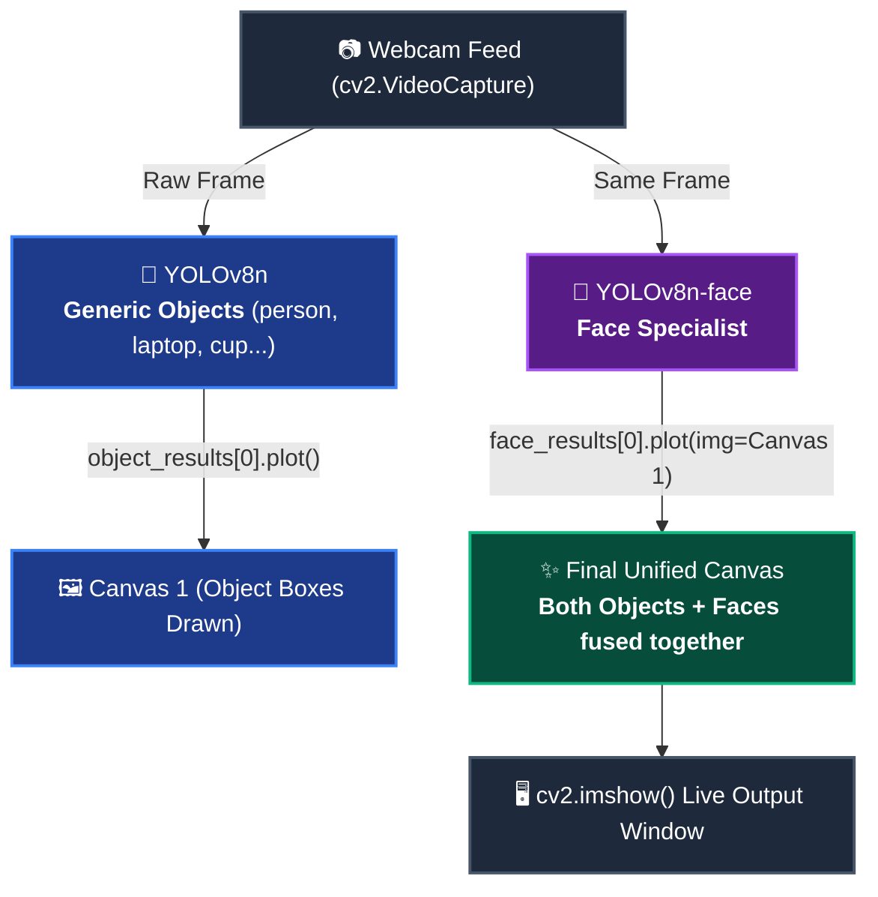

# 🎯 Real-Time Face & Object Detection with Dual YOLOv8

[](https://www.python.org/)
[](https://opencv.org/)
[](https://github.com/ultralytics/ultralytics)
[](https://pytorch.org/)
[](LICENSE)

A high-performance real-time computer vision application that simultaneously identifies **80 general everyday objects** and locks onto **human faces** within the same live video feed using an efficient dual-model overlay pipeline.

---

## 🌟 Overview

Standard object detection models (such as YOLOv8 trained on COCO) identify whole human bodies (`person`) alongside everyday items like laptops, cell phones, and chairs, but lack dedicated face bounding boxes. Conversely, facial detectors locate faces with high precision but ignore surrounding context.

This project implements a **Dual-Model Fusion Pipeline**:
1. **Model 1 (`yolov8n.pt`)**: Detects 80 common object classes in the scene.
2. **Model 2 (`yolov8n-face.pt`)**: Detects human faces with tight, high-confidence bounding boxes.
3. **Canvas Fusion**: Model 2 renders its detections directly onto the canvas pre-drawn by Model 1, producing a unified visual stream without flickering or multiple windows.

---

## 🏗️ Architecture & Dataflow



### The "Fusion Trick"
Instead of rendering to a blank background, the facial detection model accepts the pre-rendered object canvas via the `img=` parameter:

```python
# 1. Model 1 draws object boxes onto the frame
canvas = object_results[0].plot()

# 2. Model 2 paints face boxes directly on top of canvas
fused_output = face_results[0].plot(img=canvas)
```

---

## ✨ Features

- **Dual-Layer Inference:** Spot both the full person/objects and their specific face coordinates simultaneously.
- **CPU-Optimized (Nano Architecture):** Both models use lightweight Nano (`n`) weights, ensuring smooth frame rates on standard laptop hardware without requiring a dedicated GPU.
- **Silent Terminal Execution (`verbose=False`):** Per-frame inference logs are suppressed to keep the console clean and prevent I/O bottlenecks.
- **Clean Hardware Release:** Graceful shutdown when pressing `x`, releasing the webcam hardware lock and closing GUI windows properly.

---

## 🚀 Quickstart Guide

### 1. Clone the Repository
```bash
git clone https://github.com/uzowurumauritius-rgb/Python-Face-Detection.git
cd Python-Face-Detection
```

### 2. Set Up Virtual Environment
```bash
python3 -m venv .venv
source .venv/bin/activate
pip install --upgrade pip
pip install -r requirements.txt
```

### 3. Download the Face Model Weights
The general object model (`yolov8n.pt`) downloads automatically on first run. Download the pre-trained face weights into the project root:

```bash
curl -L -o yolov8n-face.pt https://huggingface.co/arnabdhar/YOLOv8-Face-Detection/resolve/main/model.pt
```

### 4. Run Live Detection
```bash
python3 live_detection.py
```
> **Tip:** Click the popup window and press **`x`** on your keyboard to exit.

---

## 📁 Project Structure

```text
Python-Face-Detection/
├── live_detection.py            # Main real-time dual-detection script
├── camera_frame_explainer.mp4   # Animated explainer of camera frames & detection
├── requirements.txt             # Python dependencies
├── .gitignore                   # Git ignore patterns for venv & large binaries
├── README.md                    # Project documentation
├── yolov8n.pt                   # (Auto-downloaded) Generic object weights
└── yolov8n-face.pt              # (Downloaded) Face detection weights
```

---

## ⚙️ Configuration & Performance

| Setting | Default | Description |
| :--- | :--- | :--- |
| **Camera Index** | `0` | Default built-in webcam. Change to `1` or `2` for external USB cameras. |
| **Inference Mode** | CPU | Runs on CPU by default. To enable NVIDIA GPU acceleration, add `.to('cuda')` to both model definitions. |
| **Exit Key** | `'x'` | Keypress monitored by `cv2.waitKey(1)`. Window must be in focus. |

---

## 🤝 Credits & Acknowledgements

- [Ultralytics YOLOv8](https://github.com/ultralytics/ultralytics) for the core neural network framework.
- [WIDER FACE](http://shuoyang1213.me/WIDERFACE/) dataset and community contributors for face detection fine-tuning.
- OpenCV community for computer vision tools.

---

## 📄 License

This project is licensed under the MIT License - see the [LICENSE](LICENSE) file for details.
