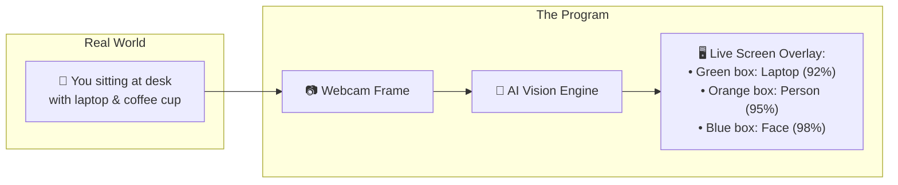
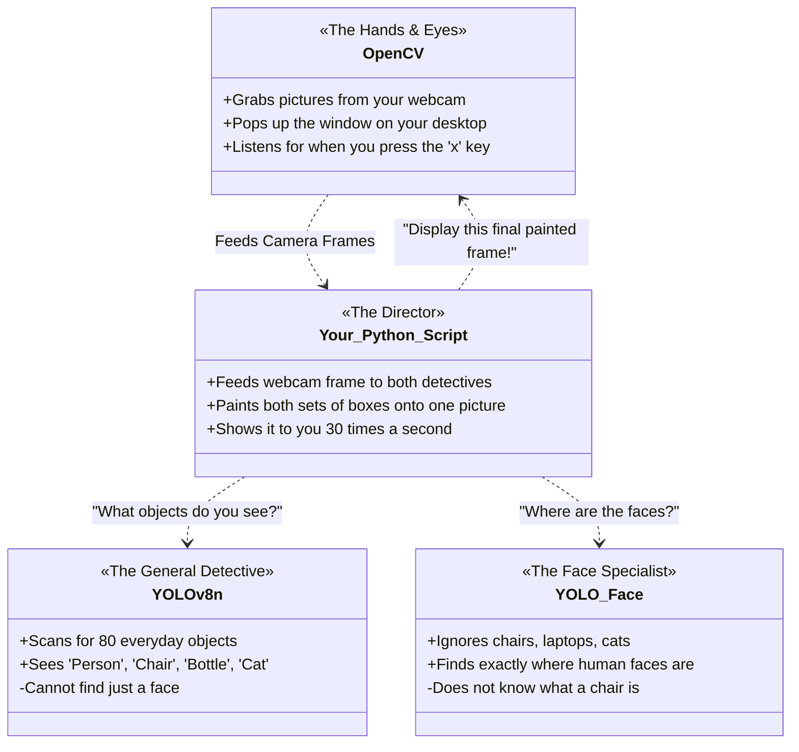
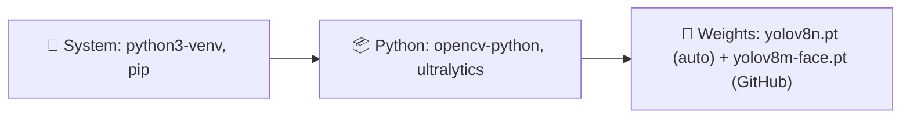
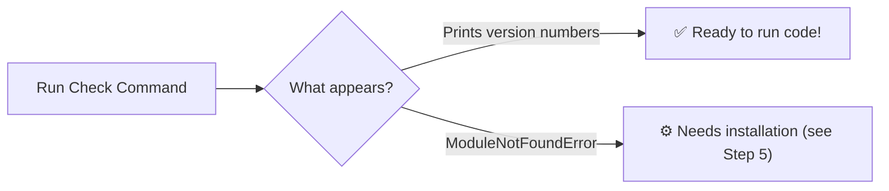
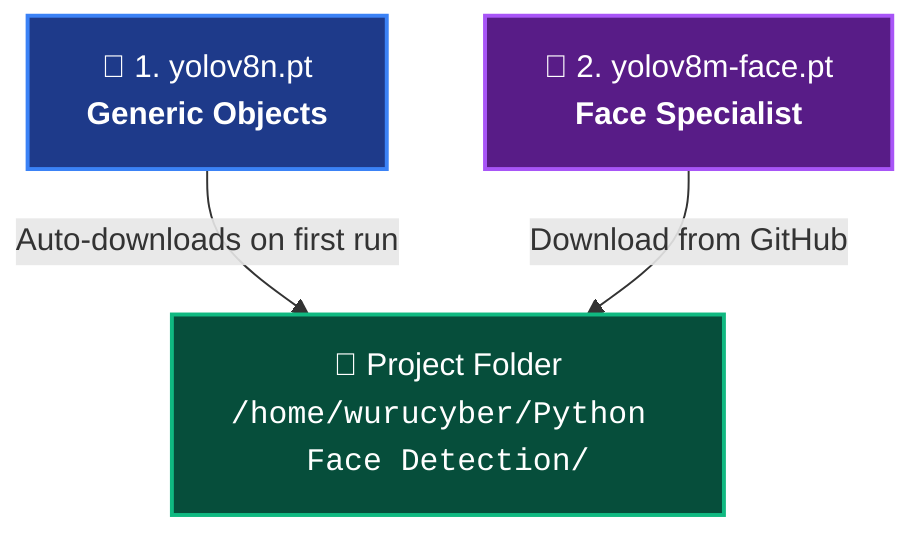
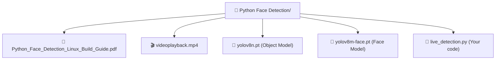
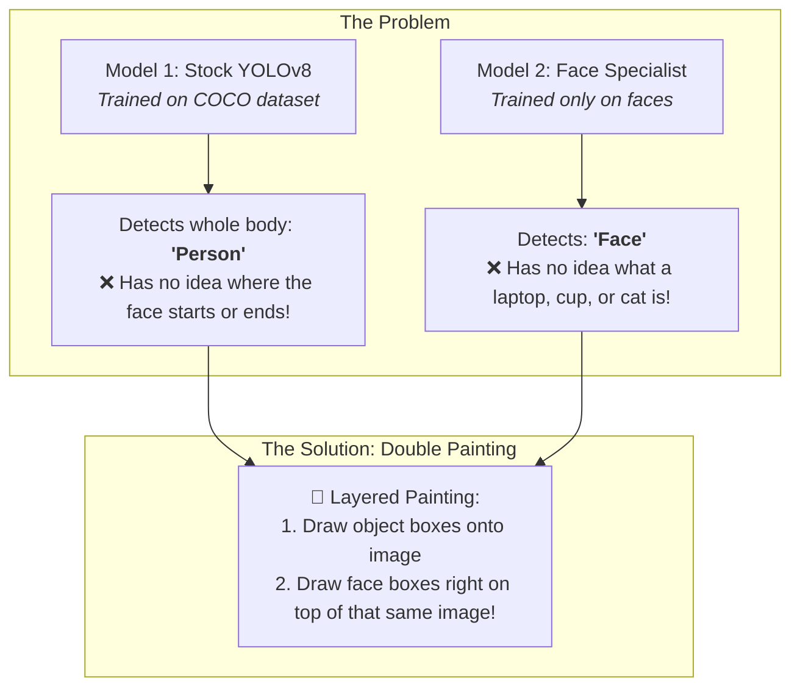
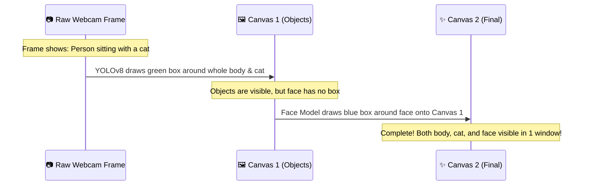

# 💡 Plain-English Visual Guide: What Is This Project?

---

## 🎯 1. The Big Picture: What Are We Actually Building?

Imagine you turn on your webcam. You want a live video box on your screen that:
1. **Identifies ordinary things** around you: "laptop", "cell phone", "chair", "cat", "person".
2. **Finds your face** with a snug, dedicated box right around your eyes, nose, and mouth.
3. **Draws both at the same time** on the same live screen without freezing.



---

## 🎭 2. The Cast: Who Does What?

Think of the project as a small movie crew where each tool has one specific job:



---

## 📦 3. Required Packages & Models (Cheat-Sheet)



| Component | Purpose | How to get it |
| :--- | :--- | :--- |
| **`python3-venv`** | Creates isolated sandboxed environments | `sudo apt install python3-venv python3-pip` |
| **`opencv-python`** | Handles camera feed, window popups & drawing | `pip install opencv-python` |
| **`ultralytics`** | Runs YOLOv8 object & face detection | `pip install ultralytics` |
| **`torch`** | Neural net math backend | Auto-installed with Ultralytics |
| **`yolov8n.pt`** | Brain for 80 common objects | Auto-downloads on first run |
| **`yolov8m-face.pt`** | Brain for human faces | [Download from GitHub](https://github.com/akanametov/yolo-face) into folder |

---

## 🔍 4. Quick Check: Do You Have Them Installed?

Run this single command in your terminal:

```bash
python3 -c "import cv2, ultralytics, torch; print('OpenCV:', cv2.__version__); print('Torch:', torch.__version__)"
```



---

## 🚀 5. Quick Setup (When You Are Ready)

To keep your main system clean, run these commands inside your project folder:

```bash
# 1. System tools
sudo apt update && sudo apt install -y python3-venv python3-pip

# 2. Create and enter virtual sandbox (.venv)
python3 -m venv .venv
source .venv/bin/activate

# 3. Install core libraries
pip install --upgrade pip
pip install opencv-python ultralytics
```

---

## 🧠 6. Downloading the YOLO Models (.pt Files)

> [!NOTE]
> **Key Concept:** YOLO models aren't "installed" with `pip`. They are **`.pt` (PyTorch weight) files** — essentially pre-trained brain files that sit directly inside your project directory alongside your Python scripts.



### Model 1: `yolov8n.pt` (Objects)
* **Where it lives:** Hosted officially by Ultralytics.
* **How to get it:** Zero effort required. The first time you run `YOLO("yolov8n.pt")` in your script, it automatically downloads itself into your folder.
* *(Optional)* If you want to download it beforehand right now:
  ```bash
  curl -L -O https://github.com/ultralytics/assets/releases/download/v8.2.0/yolov8n.pt
  ```

### Model 2: `yolov8m-face.pt` (Faces)
* **Where it lives:** On GitHub at [akanametov/yolo-face](https://github.com/akanametov/yolo-face).
* **How to get it:** You have two quick options:

#### Option A: Quick 1-Line Terminal Download (Recommended)
Open your terminal inside `/home/wurucyber/Python Face Detection` and run:
```bash
curl -L -o yolov8m-face.pt https://github.com/akanametov/yolo-face/releases/download/v0.0.0/yolov8m-face.pt
```

#### Option B: Browser Download
1. Open the [akanametov/yolo-face Releases Page](https://github.com/akanametov/yolo-face/releases).
2. Under the release assets, click `yolov8m-face.pt` to download it.
3. Move the downloaded file into your project folder: `/home/wurucyber/Python Face Detection/`

### 🎯 Verification: How Your Folder Should Look



To verify they are in place, run in your terminal:
```bash
ls -lh *.pt
```
Once you see both `.pt` files listed, your AI brains are ready to go!

---

## 🤔 7. The Core Mystery: "Why Do We Need TWO Models?"



### The Visual Painting Analogy



---

## 🧩 8. Demystifying the Jargon

| Term | What it actually means in plain English |
| :--- | :--- |
| **Bounding Box** | The colored rectangle drawn around something the AI spotted. |
| **Weights (`.pt` file)** | A frozen "brain file" created after training an AI on millions of photos. |
| **Inference** | The split-second calculation when the AI inspects a frame and classifies objects. |
| **Frame** | One still picture. Video is just 30 still pictures shown every second. |
| **Virtual Env (`.venv`)** | A private sandbox folder for project packages. |
| **`cv2.VideoCapture(0)`** | OpenCV instruction to open default webcam (index `0`). |

---

## 💻 9. The Complete Working System Code

This is the entire script tying all the pieces together:

```python
import cv2
from ultralytics import YOLO

# 1. Load the two brains
model = YOLO("yolov8n.pt")           # Object detector (auto-downloads)
face_model = YOLO("yolov8m-face.pt") # Face detector (from GitHub)

# 2. Turn on camera
cap = cv2.VideoCapture(0)
if not cap.isOpened():
    raise SystemExit("Error: Could not open webcam.")

# 3. Main real-time loop (runs until 'x' is pressed)
while cv2.waitKey(1) != ord("x"):
    ok, frame = cap.read()
    if not ok or frame is None:
        continue

    # Both models inspect the exact same frame
    r = model(frame, verbose=False)
    fr = face_model(frame, verbose=False)

    # Fusion trick: Layer face boxes over object boxes
    fused_image = fr[0].plot(img=r[0].plot())

    cv2.imshow("Live Detection Window (Press 'x' to quit)", fused_image)

# 4. Clean exit
cap.release()
cv2.destroyAllWindows()
```
